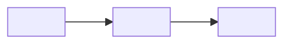

# 🚀 Nuevo DAG: `<dag_id>`

## 📝 Descripción
<!-- Qué pipeline se agrega, qué problema resuelve y con qué frecuencia corre. -->

<!-- Dónde vive la lógica (archivo del DAG y módulos en scripts/) y qué patrón del curso sigue. -->

**Ticket de Jira:** N/A

---

## ⚙️ Especificaciones del DAG
* **DAG ID:** `<dag_id>`
* **Schedule:** `<cron>` (`<descripción en hora local y zona horaria>`)
* **Catchup:** `<True | False>`
* **Owner:** `<owner>`
* **Reintentos:** `<n>` reintento(s), espera de `<m>` minuto(s)
* **SLA:** `<no configurado | duración>`
* **Fecha de inicio:** `<YYYY-MM-DD>` (`<zona horaria>`)
* **Tags:** `<tag_1>`, `<tag_2>`

---

## 🗺️ Linaje de datos y arquitectura
* **Origen:** `<ruta local, API o sistema de origen>`
* **Conexión:** `<conexión de Airflow, si aplica>`
* **Destino:** `<ruta local o servicio de destino>`

### Flujo de tareas

---

## 🧪 Checklist de pruebas
Verificar que estas validaciones se ejecutaron y pasaron:
- [ ] **Integridad local:** el archivo del DAG se carga en el entorno de Airflow en ejecución sin errores de importación (`airflow dags list-import-errors` no devolvió datos).
- [ ] **Parser de Airflow:** `<dag_id>` aparece en `airflow dags list` desde `/opt/airflow/dags/<archivo>.py`.
- [ ] **Ejecución de la tarea:** una corrida manual de `<task_id>` completó el flujo. Log: `<mensaje relevante del log>`.
- [ ] **Pruebas unitarias:** `<se agregó cobertura con pytest | se reutilizó código existente sin cobertura nueva>`.

Prueba del DAG en Airflow local.

<!-- Pegar capturas de la corrida. -->

---

## 📸 Grafo de Airflow / vista del código

<!-- Pegar captura del grafo del DAG en la UI. -->
